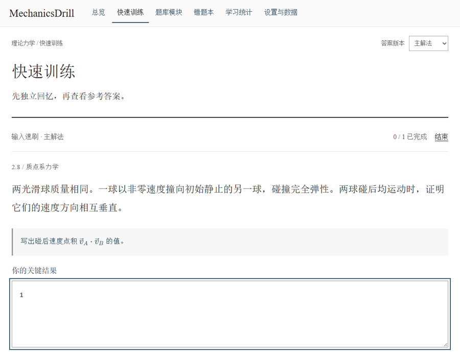
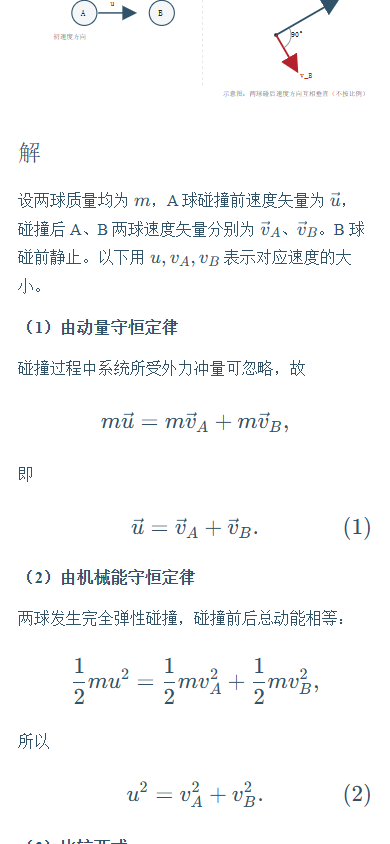

# MechanicsDrill

**A theoretical mechanics drill for written exams. Work out the equations on paper, then compare your derivation.**

[Open the app](https://hnnuyuxuan.github.io/MechanicsDrill/) · [Sources and workspace](docs/workspace.md) · [简体中文](README.md)

## Practice

The bank includes 13 adapted exercises from the fifth edition of *Theoretical Mechanics* by Zhou Yanbai. Six cover systems of particles and seven cover rigid bodies. Filter by chapter, topic, or study status and choose source order, weighted random order, or unlimited practice.

| Mode | How it works |
| --- | --- |
| Quick input | Enter the requested number or expression. A reference match is recorded automatically. Compare differences and assess equivalent forms yourself. |
| Written practice | Work on paper, then reveal the result, derivation, diagrams, and marking points. |
| Error spotting | Judge a statement or equation and review the explanation. This mode has separate statistics. |

Solutions state the givens and objective, develop the equations, and report the result. Vectors use arrows above the symbols. Problem 2.13 offers a force-based derivation and an energy-conservation derivation.

Wrong and uncertain answers enter the review list. Three consecutive correct attempts mark an exercise mastered. Review intervals are 1, 3, 7, and 14 days. The browser saves drafts, sessions, and history. Use the settings page to export and restore a full JSON backup.

## Development

Use Node.js 24 and npm.

~~~sh
npm ci
npm run dev
~~~

Open the [local site](http://127.0.0.1:5173/MechanicsDrill/). After editing question or solution sources, run `npm run bank`, `npm run lint`, `npm test`, and `npm run build`. GitHub Actions builds and deploys `dist/` to Pages.

The interface and practice workflow are based on [PhysDrill](https://github.com/HNNUYUXUAN/PhysDrill). The application code is available under the [MIT license](LICENSE). See the [workspace notes](docs/workspace.md) for the textbook reference and figure provenance.
