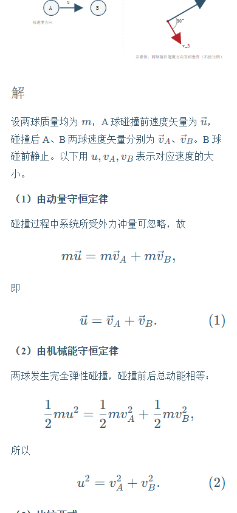

# MechanicsDrill

**理论力学考前训练。先在纸上列式，再对照规范推导。**

[在线练习](https://hnnuyuxuan.github.io/MechanicsDrill/) · [题源与工作区](docs/workspace.md) · [English](README.en.md)

## 开始练习

题库收录《理论力学教程》第五版第二章 **质点系力学**（6 题）和第三章 **刚体力学**（7 题）。可按章节、知识点和学习状态筛选，支持顺序、加权随机及无限训练。

| 训练方式 | 操作 |
| --- | --- |
| 输入速刷 | 输入题目指定的数字或表达式。匹配参考写法时自动记为掌握；出现差异时可以逐符号订正并自评。 |
| 纸笔默写 | 独立完成整题后，展开参考结论、完整推导、示意图和阅卷要点。 |
| 易错辨析 | 判断列式或推理是否成立，再看依据。辨析记录单独统计。 |

参考解答按已知与求、列式、推导、作答组织。速度、力、角速度和单位向量用上标箭头。第 2.13 题可切换动力学与机械能守恒两套推导。

答错和不确定的题进入错题本。连续答对 3 次标记为已掌握，复习间隔依次为 1、3、7、14 天。浏览器保存草稿、会话和学习历史。换设备时，在「设置与数据」导出并导入完整 JSON 备份。

## 本地开发

使用 Node.js 24 和 npm。

~~~sh
npm ci
npm run dev
~~~

打开 [本地站点](http://127.0.0.1:5173/MechanicsDrill/)。修改题目和解答后运行 `npm run bank`，再执行 `npm run lint`、`npm test`、`npm run build`。GitHub Actions 构建 `dist/` 并发布到 Pages。

~~~mermaid
flowchart LR
  A[题目 JSON 与解答 Markdown] --> B[题库生成]
  B --> C[React 与 KaTeX 训练页]
  C <--> D[浏览器学习记录]
  D <--> E[JSON 备份]
~~~

界面和训练流程沿用 [PhysDrill](https://github.com/HNNUYUXUAN/PhysDrill)，习题和解答按理论力学改编。应用源码使用 [MIT 许可证](LICENSE)。教材出处和公开素材范围见[题源与工作区](docs/workspace.md)。
