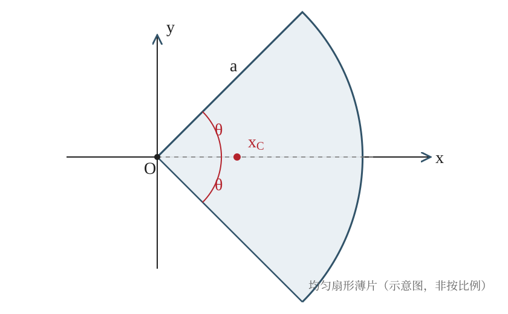

## 已知与求

一片均匀薄片呈圆扇形，半径为 $a$，张角为 $2\theta$。求质心位置，并讨论 $\theta=\pi/2$ 时的结果。

## 解

### （1）取坐标系并利用对称性

以扇形圆心 $O$ 为原点，以扇形对称轴为 $x$ 轴。由关于 $x$ 轴的对称性，质心必在对称轴上，因此 $y_C=0$。

### （2）建立极坐标微元

令极径为 $r$，极角为 $\varphi$，则 $0\le r\le a$、$-\theta\le\varphi\le\theta$。设均匀面密度为 $\sigma$，面积元与质量元分别为 $\mathrm dA=r\,\mathrm dr\,\mathrm d\varphi$、$\mathrm dm=\sigma r\,\mathrm dr\,\mathrm d\varphi$。

### （3）计算总质量

扇形总质量为 $M=\int\mathrm dm=\sigma\int_{-\theta}^{\theta}\int_0^a r\,\mathrm dr\,\mathrm d\varphi=\sigma a^2\theta$。

### （4）计算质心坐标

由质心定义，$x_C=\dfrac{1}{M}\int x\,\mathrm dm$。在极坐标中 $x=r\cos\varphi$，故 $x_C=\dfrac{\sigma}{M}\int_{-\theta}^{\theta}\int_0^a r^2\cos\varphi\,\mathrm dr\,\mathrm d\varphi=\dfrac{\sigma}{M}\cdot\dfrac{a^3}{3}\cdot2\sin\theta=\dfrac{2a\sin\theta}{3\theta}$。

### （5）验证半圆片

半圆片对应 $2\theta=\pi$，即 $\theta=\pi/2$。代入得 $x_C=\dfrac{2a}{3(\pi/2)}=\dfrac{4a}{3\pi}$，证毕。

## 答

$y_C=0,\quad x_C=\dfrac{2a\sin\theta}{3\theta}$。当 $\theta=\dfrac{\pi}{2}$ 时，$x_C=\dfrac{4a}{3\pi}$。

## 阅卷要点

- 对称性判断，得出 $y_C=0$（1分）
- 正确建立极坐标范围和质量元（2分）
- 正确计算扇形总质量 $M=\sigma a^2\theta$（2分）
- 按质心定义建立并计算 $x_C$ 积分（3分）
- 代入半圆条件，证明 $4a/(3\pi)$（2分）

## 易错点

- 把圆心角 $2\theta$ 误写为 $\theta$，导致总面积少一半。
- 忘记面积元中的极坐标雅可比因子 $r$。
- 只写出对称性结论，没有完成质心积分。
- 半圆条件应为 $\theta=\pi/2$，不是 $\theta=\pi$。
