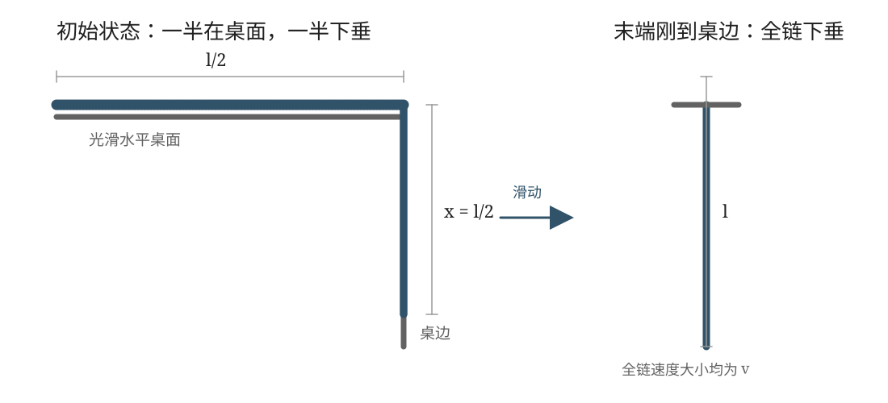

## 已知与求

一根长为 $l$ 的均匀细链跨过光滑桌边，桌面上的一段与边缘垂直，初始下垂段长 $l/2$。细链从静止释放。用两种方法求链尾刚到桌边的速率。

## 解

设链条线密度为 $\mu$，总质量为 $M=\mu l$。取链条下垂长度为广义坐标 $x$，则初始时 $x_0=l/2$，当链条末端刚滑到桌边时 $x_1=l$。设链条各处速率大小为 $v=\dot x$。桌面及桌边均光滑，忽略空气阻力。
### 机械能守恒

取桌面为重力势能零势面。链条下垂长度为 $x$ 时，下垂部分的重力势能为

$$
U(x)=\mu g\int_0^x(-y)\,dy=-\frac12\mu gx^2.
$$

初始时 $x_0=l/2$，链条静止，故

$$
E_0=U(l/2)=-\frac18\mu gl^2.
$$

末端刚到桌边时 $x_1=l$，整条链的速率大小均为 $v$，总动能为

$$
K_1=\frac12\mu l v^2,
$$

重力势能为

$$
U_1=U(l)=-\frac12\mu gl^2.
$$

桌面支持力和光滑桌边的约束力均不做功，系统机械能守恒：

$$
K_1+U_1=E_0.
$$

代入得

$$
\frac12\mu l v^2-\frac12\mu gl^2=-\frac18\mu gl^2,
$$

整理得

$$
\frac12\mu l v^2=\frac38\mu gl^2,
 \qquad \boxed{v=\frac12\sqrt{3gl}}.
$$

## 答

$v=\dfrac12\sqrt{3gl}$。

## 阅卷要点

1. 明确线密度 $\mu$、总质量 $\mu l$ 及下垂长度的初末值 $l/2$、$l$。
2. 牛顿方法中说明桌面和桌边光滑、约束力无切向分量；沿链条切向积分时两端张力为零。
3. 能量方法中计算的是**整条链**的动能，不能只取下垂部分质量。
4. 势能只需计算下垂部分，并正确处理初、末态势能差。
5. 最终结果应为 $v=\frac12\sqrt{3gl}$，量纲为速度。

## 易错提醒

- 链条总质量始终为 $\mu l$，不是 $\mu x$；$\mu x$ 只是下垂部分的质量。
- 链条各处速率大小相同，因此总动能为 $\frac12\mu l v^2$。
- 不能把桌面支持力误计为沿链条运动方向的驱动力。
