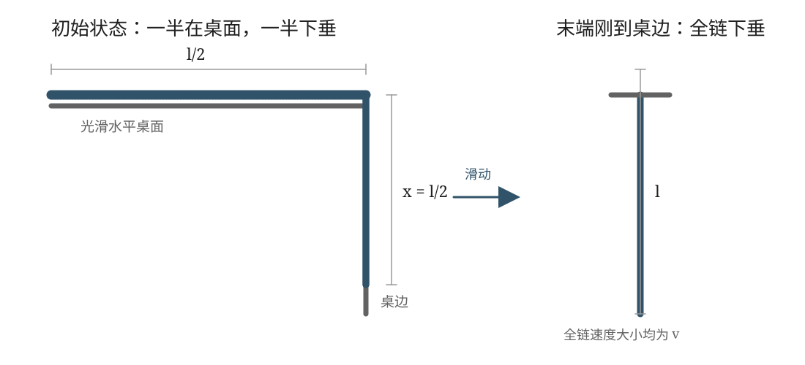

## 已知与求

一根长为 $l$ 的均匀细链跨过光滑桌边，桌面上的一段与边缘垂直，初始下垂段长 $l/2$。细链从静止释放。用两种方法求链尾刚到桌边的速率。

## 解

设链条线密度为 $\mu$，总质量为 $M=\mu l$。取链条下垂长度为广义坐标 $x$，则初始时 $x_0=l/2$，当链条末端刚滑到桌边时 $x_1=l$。设链条各处速率大小为 $v=\dot x$。桌面及桌边均光滑，忽略空气阻力。
### 沿链切向列动力学方程

取链条从桌面上的自由端到下垂自由端的弧长坐标 $s$，正向与链条瞬时运动方向一致；张力为 $T(s)$，沿链条运动方向的切向加速度大小为 $a=dv/dt$。对长度为 $ds$ 的微元，沿切线方向列牛顿第二定律：

$$
\frac{dT}{ds}+\mu g_\tau=\mu a,
$$

其中 $g_\tau$ 是重力加速度在链条切线方向上的分量。光滑桌面及桌边的约束力沿接触法线方向，在切线方向无分量。对整条链积分：

$$
T(l)-T(0)+\mu\int_0^l g_\tau\,ds=\mu la.
$$

链条两端均为自由端，故 $T(0)=T(l)=0$。桌面上的水平部分重力沿链方向的分量为零；下垂部分长度为 $x$，重力沿链方向，故

$$
\int_0^l g_\tau\,ds=gx.
$$

于是

$$
\mu gx=\mu la,\qquad a=\frac{gx}{l}. \tag{1}
$$

又因为 $a=dv/dt=v\,dv/dx$，将式（1）分离变量并积分：

$$
v\,dv=\frac{g}{l}x\,dx,
$$

$$
\int_0^v v\,dv=\frac{g}{l}\int_{l/2}^{l}x\,dx.
$$

因此

$$
\frac{v^2}{2}=\frac{g}{2l}\left(l^2-\frac{l^2}{4}\right)
 =\frac{3gl}{8},
$$

得到

$$
\boxed{v=\frac12\sqrt{3gl}}. \tag{2}
$$

## 答

$v=\dfrac12\sqrt{3gl}$。

## 阅卷要点

1. 明确线密度 $\mu$、总质量 $\mu l$ 及下垂长度的初末值 $l/2$、$l$。
2. 牛顿方法中说明桌面和桌边光滑、约束力无切向分量；沿链条切向积分时两端张力为零。
3. 能量方法中计算的是**整条链**的动能，不能只取下垂部分质量。
4. 势能只需计算下垂部分，并正确处理初、末态势能差。
5. 最终结果应为 $v=\frac12\sqrt{3gl}$，量纲为速度。

## 易错提醒

- 链条总质量始终为 $\mu l$，不是 $\mu x$；$\mu x$ 只是下垂部分的质量。
- 链条各处速率大小相同，因此总动能为 $\frac12\mu l v^2$。
- 不能把桌面支持力误计为沿链条运动方向的驱动力。
