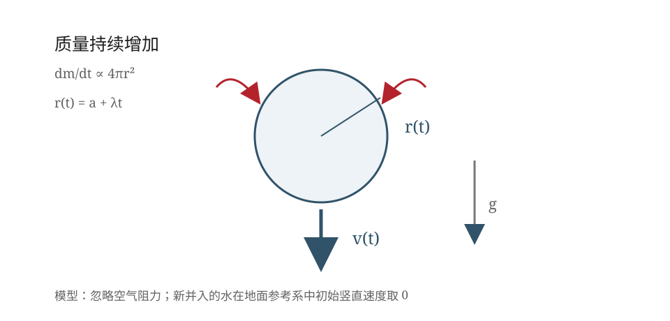

## 已知与求

球形雨滴的密度恒定，吸收水分的质量速率与其表面积成正比。设雨滴由静止释放、初始半径为 $a$，并入的水分对地竖直速度为零。忽略空气阻力，求速度随时间的变化。

## 解

设雨滴始终为密度 $\rho$ 不变的球形，半径为 $r(t)$，质量为 $m(t)$，取竖直向下为正方向。忽略空气阻力，并按教材采用的变质量模型，取新并入雨滴的水在地面惯性系中的初始竖直速度为零。设 $t=0$ 时雨滴由静止开始下落，初始半径为 $a$。

**（1）由质量增长规律求半径随时间的变化**

题设给出质量增加率与表面积成正比，设比例常数为 $k$，则

$$
\frac{dm}{dt}=k\,4\pi r^2. \tag{1}
$$

另一方面，雨滴质量为

$$
m=\frac43\pi\rho r^3,
$$

对时间求导：

$$
\frac{dm}{dt}=4\pi\rho r^2\frac{dr}{dt}. \tag{2}
$$

比较式（1）、（2），得

$$
\frac{dr}{dt}=\frac{k}{\rho}\equiv\lambda,
$$

其中 $\lambda$ 为单位时间内雨滴半径的增加量。由初始条件 $r(0)=a$，积分得

$$
r(t)=a+\lambda t. \tag{3}
$$

**（2）建立变质量运动方程**

由于新并入的水在地面惯性系中初始竖直速度为零，系统的动量方程为

$$
\frac{d(mv)}{dt}=mg.
$$

展开并整理：

$$
m\frac{dv}{dt}+v\frac{dm}{dt}=mg,
$$

$$
\frac{dv}{dt}+\frac{1}{m}\frac{dm}{dt}v=g. \tag{4}
$$

由 $m\propto r^3$ 及式（3），有

$$
\frac{1}{m}\frac{dm}{dt}=3\frac{1}{r}\frac{dr}{dt}
 =\frac{3\lambda}{a+\lambda t}.
$$

代入式（4）：

$$
\frac{dv}{dt}+\frac{3\lambda}{a+\lambda t}v=g. \tag{5}
$$

**（3）求解微分方程**

式（5）是一阶线性微分方程，其积分因子为

$$
\mu(t)=\exp\!\left(\int\frac{3\lambda}{a+\lambda t}\,dt\right)
 =(a+\lambda t)^3.
$$

方程两边乘以积分因子，得

$$
\frac{d}{dt}\left[(a+\lambda t)^3v\right]
 =g(a+\lambda t)^3.
$$

利用初始条件 $v(0)=0$，从 $0$ 到 $t$ 积分：

$$
(a+\lambda t)^3v
 =g\int_0^t(a+\lambda\tau)^3\,d\tau
 =\frac{g}{4\lambda}\left[(a+\lambda t)^4-a^4\right].
$$

因此，雨滴速度与时间的关系为

$$
\boxed{v(t)=\frac{g}{4\lambda}\left[a+\lambda t-\frac{a^4}{(a+\lambda t)^3}\right]}.
$$

式中 $\lambda$ 为单位时间内雨滴半径的增加量，$a$ 为 $t=0$ 时雨滴的半径；速度方向竖直向下。

## 答

$v(t)=\dfrac{g}{4\lambda}\left[a+\lambda t-\dfrac{a^4}{(a+\lambda t)^3}\right]$，方向向下。

## 阅卷要点

1. 由球形质量公式 $m=\frac43\pi\rho r^3$ 对时间求导，推出半径匀速增长 $r=a+\lambda t$。
2. 正确写出变质量动量方程，并交代新并入质量的初始速度条件。
3. 将 $m'/m$ 化为 $3\lambda/(a+\lambda t)$，得到一阶线性微分方程。
4. 正确写出积分因子 $(a+\lambda t)^3$，并使用 $v(0)=0$ 确定积分常数。
5. 最终表达式与教材给出的结果一致。

## 易错提醒

- 不能直接写成 $m\,dv/dt=mg$：雨滴质量随时间增加，必须处理动量流入项。
- $\lambda$ 的量纲是长度/时间，表示半径增长率，不是质量增长率。
- 本题的教材结果采用 $v(0)=0$；若给定非零初速度 $v_0$，解中还应增加 $v_0a^3/(a+\lambda t)^3$ 项。
