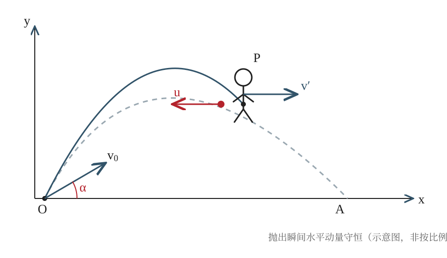

## 已知与求

一名重为 $G$ 的人拿着重为 $G_1$ 的物体，以速率 $v_0$ 沿与水平面成 $\alpha$ 的方向起跳。在最高点，他将物体以相对自己为 $u$ 的速率水平向后抛出。忽略空气阻力，落地与起跳同高。求跳远距离的增量。

## 解

### （1）明确研究过程与质量

研究物体被抛出的瞬间。设人的质量为 $m=G/g$，手中物体的质量为 $m_1=G_1/g$。抛出过程极短，忽略外界水平冲量，因此人和物体组成的系统在水平方向动量守恒。

### （2）列抛出前后的水平动量守恒式

到达最高点时，竖直速度为零，水平方向速度仍为 $v_0\cos\alpha$。设抛出后人的水平速度为 $v$。物体相对人向后速度为 $u$，故物体对地的水平速度为 $v-u$。于是 $(m+m_1)v_0\cos\alpha=mv+m_1(v-u)$。

### （3）求人的水平速度增量

整理动量守恒式，得 $v-v_0\cos\alpha=\dfrac{m_1}{m+m_1}u=\dfrac{G_1}{G+G_1}u$。因此，抛出物体使人的水平速度增加 $\Delta v_x=\dfrac{G_1}{G+G_1}u$。

### （4）计算最高点后的下落时间

抛出方向水平，人的竖直速度不发生突变，仍为零。人从最高点落回起跳高度的时间等于上升时间，即 $t=\dfrac{v_0\sin\alpha}{g}$。

### （5）求跳跃距离的增加量

增加的水平距离等于水平速度增量乘以下落时间：$\Delta s=\Delta v_x t=\dfrac{G_1}{G+G_1}u\cdot\dfrac{v_0\sin\alpha}{g}$。

## 答

$\boxed{\Delta s=\dfrac{G_1}{G+G_1}\,\dfrac{u v_0\sin\alpha}{g}}$。

## 阅卷要点

- 将重力换算为质量，明确研究对象和抛出瞬间（1分）
- 正确写出水平动量守恒式，并处理相对速度（3分）
- 正确求出人的水平速度增量（3分）
- 正确确定最高点到落地的时间（2分）
- 得到距离增加量并写出最终结果（1分）

## 易错点

- 把重力 $G,G_1$ 直接当作质量使用，漏掉换算关系；虽然质量比中 $g$ 会约去，但推导中仍应说明。
- 把物体对地速度误写成 $v+u$，忽略“向后”这一方向。
- 在最高点误认为水平速度为零；最高点只有竖直分速度为零。
- 把完整飞行时间误当作最高点后的剩余时间。
