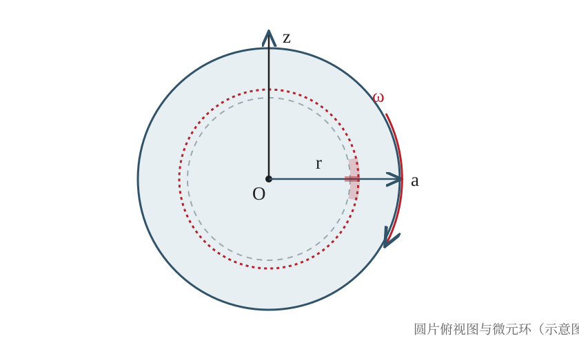

## 已知与求

半径为 $a$、质量为 $m$ 的均匀薄圆片绕过圆心并垂直片面的固定轴以角速度大小 $\omega$ 匀速转动。求动量矩的大小与方向。

## 解

### （1）写出绕定轴的角动量表达式

对刚体绕固定轴转动，绕该轴的动量矩为 $J=\int r v_\theta\,\mathrm dm$。由于 $v_\theta=\omega r$，故 $J=\omega\int r^2\,\mathrm dm=I\omega$。

### （2）建立面密度和环形质量元

圆片面密度为 $\sigma=\dfrac{m}{\pi a^2}$。取半径为 $r$、宽度为 $\mathrm dr$ 的微小同心圆环，则 $\mathrm dm=\sigma\,2\pi r\,\mathrm dr$。

### （3）计算转动惯量

$I=\int_0^a r^2\,\mathrm dm=2\pi\sigma\int_0^a r^3\,\mathrm dr=2\pi\sigma\cdot\dfrac{a^4}{4}=\dfrac{\pi\sigma a^4}{2}=\dfrac12 ma^2$。

### （4）求动量矩

代入 $J=I\omega$，得到 $J=\dfrac12 ma^2\omega$。动量矩矢量沿转轴方向，具体正负由角速度矢量方向决定。

## 答

$\vec J=\tfrac12 ma^2\vec\omega$。 动量矩与角速度同向。

## 阅卷要点

- 正确使用角动量定义，写出 $J=I\omega$（2分）
- 正确写出均匀面密度及环形质量元（2分）
- 正确建立并计算转动惯量积分（4分）
- 得到动量矩大小及方向（2分）

## 易错点

- 误用实心球或细圆环的转动惯量公式。
- 环形质量元漏掉周长因子 $2\pi r$。
- 积分时将 $r^2$ 与质量元中的 $r$ 相乘后幂次写错。
- 只求出转动惯量 $I$，没有再乘角速度 $\omega$。
