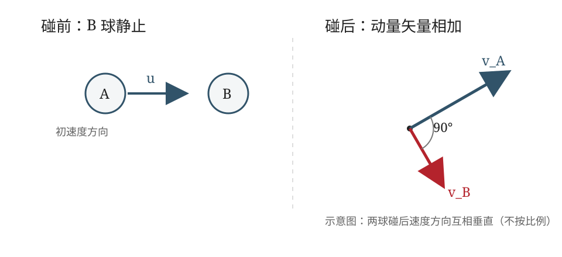

## 已知与求

两光滑球质量相同。一球以非零速度撞向初始静止的另一球，碰撞完全弹性。两球碰后均运动时，证明它们的速度方向相互垂直。

## 解

设两球质量均为 $m$，A 球碰撞前速度矢量为 $\vec{u}$，碰撞后 A、B 两球速度矢量分别为 $\vec{v}_A$、$\vec{v}_B$。B 球碰前静止。以下用 $u,v_A,v_B$ 表示对应速度的大小。

**（1）由动量守恒定律**

碰撞过程中系统所受外力冲量可忽略，故

$$
m\vec{u}=m\vec{v}_A+m\vec{v}_B,
$$

即

$$
\vec{u}=\vec{v}_A+\vec{v}_B. \tag{1}
$$

**（2）由机械能守恒定律**

两球发生完全弹性碰撞，碰撞前后总动能相等：

$$
\frac12mu^2=\frac12mv_A^2+\frac12mv_B^2,
$$

所以

$$
u^2=v_A^2+v_B^2. \tag{2}
$$

**（3）比较两式**

将式（1）两边作矢量点积，得

$$
u^2=\lvert\vec{v}_A+\vec{v}_B\rvert^2
 =v_A^2+v_B^2+2\vec{v}_A\cdot\vec{v}_B. \tag{3}
$$

由式（2）、（3）相比较，得到

$$
\vec{v}_A\cdot\vec{v}_B=0.
$$

因此，在两球碰后速度均非零的斜碰情形下，

$$
\boxed{\vec{v}_A\perp\vec{v}_B}.
$$

**证毕。**

## 答

$\vec v_A\cdot\vec v_B=0$，故 $\vec v_A\perp\vec v_B$。

## 阅卷要点

1. 正确写出碰撞前后系统的动量守恒关系，并利用 B 球初始静止、两球质量相等化简。
2. 正确使用完全弹性碰撞的动能守恒条件。
3. 对动量矢量关系平方，保留交叉项 $2\vec{v}_A\cdot\vec{v}_B$。
4. 比较两式得点积为零，并据此说明两速度方向垂直。

## 易错提醒

- 动量守恒式是**矢量式**，不能把速度大小直接作普通代数相加。
- 完全弹性碰撞对应动能守恒；仅写动量守恒不足以证明垂直关系。
- 结论是两速度矢量点积为零，而不是两球速度大小相等。
