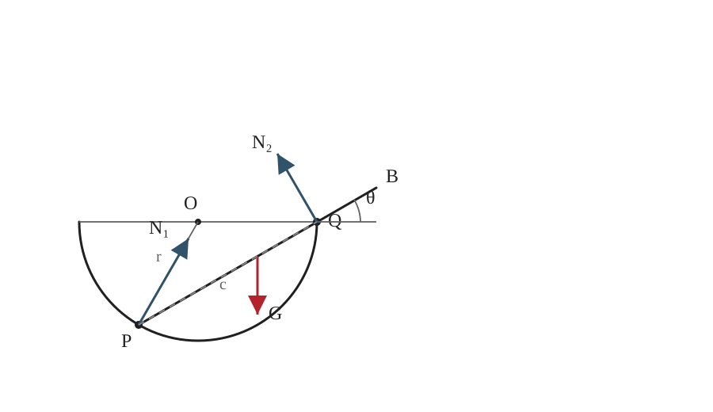

## 已知

半球形碗半径为 $r$，均质棒全长为 $L$，棒在碗内的长度为 $c$。设棒与水平面的夹角为 $\theta$，棒重为 $G$。碗内壁光滑，碗缘与棒的接触亦按光滑接触处理。

## 求

证明

$$
L=\frac{4(c^2-2r^2)}{c}.
$$

## 解

**（1）受力分析与几何关系**

设 $P$ 为棒与碗内球面的接触点，$Q$ 为棒与碗缘的接触点。内壁支持力 $N_1$ 沿接触点处球面的法线，即沿半径指向球心；碗缘对棒的支持力 $N_2$ 垂直于棒；重力 $G$ 作用于棒的中点。由弦与半径的几何关系，内壁法线与水平正方向的夹角为 $2\theta$，故其分量分别为 $N_1\cos2\theta$ 和 $N_1\sin2\theta$。

棒在碗内的部分 $PQ=c$ 是球截面中的弦。由弦长与圆心到弦的距离关系，

$$
\boxed{c=2r\cos\theta},\qquad \cos\theta=\frac{c}{2r}.
\tag{1}
$$

**（2）列平衡方程**

取水平向右、竖直向上为正方向。由图中支持力方向，沿 $x$、$y$ 轴分别有

$$
\sum F_x=0:\quad N_1\cos 2\theta-N_2\sin\theta=0,
\tag{2}
$$

$$
\sum F_y=0:\quad N_1\sin 2\theta+N_2\cos\theta-G=0.
\tag{3}
$$

对点 $P$ 取矩，$N_1$ 的力矩为零，$N_2$ 的力臂为 $c$，重力的力臂为 $\frac L2\cos\theta$，故

$$
\sum M_P=0:\quad N_2c-G\frac L2\cos\theta=0.
\tag{4}
$$

**（3）求解**

由式（2）得

$$
N_1=\frac{N_2\sin\theta}{\cos 2\theta}.
$$

代入式（3），并利用

$$
\sin\theta\sin2\theta+\cos\theta\cos2\theta
=\cos(2\theta-\theta)=\cos\theta,
$$

可得

$$
N_2\frac{\cos\theta}{\cos2\theta}=G,
\qquad
N_2=\frac{G\cos2\theta}{\cos\theta}.
\tag{5}
$$

将式（5）代入式（4），得到

$$
L=\frac{2c\cos2\theta}{\cos^2\theta}
=\frac{2c(2\cos^2\theta-1)}{\cos^2\theta}.
\tag{6}
$$

再将式（1）代入式（6）：

$$
\begin{aligned}
L&=\frac{2c\left(2\frac{c^2}{4r^2}-1\right)}{\frac{c^2}{4r^2}}\\
&=\frac{4c^2-8r^2}{c}
=\frac{4(c^2-2r^2)}{c}.
\end{aligned}
$$

## 答

$$
\boxed{L=\frac{4(c^2-2r^2)}{c}}.
$$

证毕。

## 阅卷要点

1. 正确标出内壁法向力、碗缘支持力和重力的方向。
2. 写出弦长关系 $c=2r\cos\theta$。
3. 正确列出两个方向的平衡方程。
4. 对内壁接触点取矩，得到力矩方程。
5. 消去支持力并代入几何关系，得到目标式。
