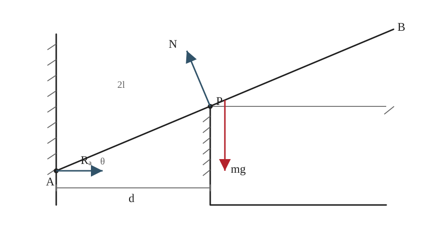

## 已知

均质棒长为 $2l$，重力为 $mg$。棒的端点 $A$ 抵在光滑竖直墙上，棒身在距墙水平距离为 $d$ 的光滑棱角 $P$ 处接触，棒与水平面夹角为 $\theta$。题设给出 $d\le l\cos\theta$，保证接触点位于棒的相应区段内。

## 求

求平衡时的 $\theta$。

## 解

**（1）受力分析与几何关系**

墙面光滑，故 $A$ 点反力 $R_A$ 水平；棱角光滑，故 $P$ 点反力 $N$ 垂直于棒；重力 $mg$ 作用于棒的中点，距 $A$ 点为 $l$。

由接触点的水平投影关系，

$$
AP\cos\theta=d,
\qquad AP=\frac{d}{\cos\theta}.
\tag{1}
$$

**（2）列平衡方程**

对点 $A$ 取矩，墙面反力 $R_A$ 的力矩为零，得到

$$
N\cdot AP-mg\,l\cos\theta=0.
\tag{2}
$$

沿竖直方向列力平衡方程：

$$
N\cos\theta-mg=0,
\qquad N=\frac{mg}{\cos\theta}.
\tag{3}
$$

**（3）求解**

将式（1）、（3）代入式（2）：

$$
\frac{mg}{\cos\theta}\cdot\frac{d}{\cos\theta}
=mg\,l\cos\theta.
$$

约去 $mg$，整理得

$$
d=l\cos^3\theta,
\qquad \cos\theta=\left(\frac dl\right)^{1/3}.
$$

由于棒与水平面的夹角取锐角，故

$$
\boxed{\theta=\arccos\!\left[\left(\frac{d}{l}\right)^{1/3}\right]}.
$$

## 答

$$
\boxed{\theta=\arccos\!\left[\left(\frac{d}{l}\right)^{1/3}\right]}.
$$

与教材印刷答案一致。

## 阅卷要点

1. 正确判断两处光滑接触的反力方向。
2. 写出 $AP=d/\cos\theta$。
3. 对 $A$ 点取矩。
4. 利用竖直方向平衡消去支持力，得到 $d=l\cos^3\theta$。
