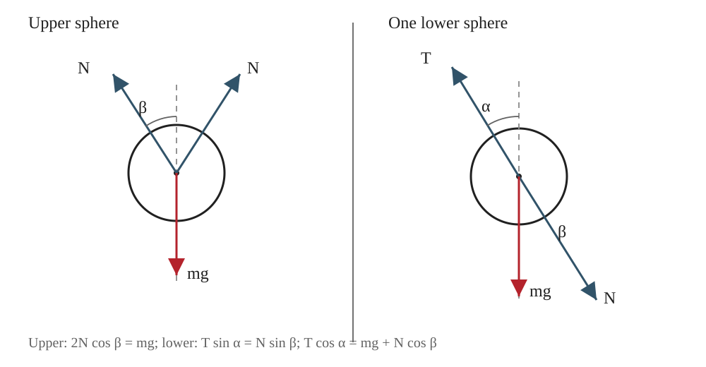

## 已知

两个相同的下方均质光滑球由两根绳悬挂于固定点 $O$，两绳与竖直方向的夹角均为 $\alpha$。两球共同支持一个与它们等重的上方均质光滑球。上方球与任一下方球的球心连线和竖直方向的夹角为 $\beta$。设每个球的重力均为 $mg$。

## 求

求 $\alpha$ 与 $\beta$ 的关系。

## 解

**（1）研究上方球**

上方球受重力 $mg$ 以及左右两个下方球的支持力。由对称性，两支持力大小相等，均记为 $N$，方向沿球心连线。上方球竖直方向平衡：

$$
2N\cos\beta-mg=0,
\qquad N\cos\beta=\frac{mg}{2}.
\tag{1}
$$

**（2）研究右侧下方球**

右侧下方球受三个力：绳张力 $T$、上方球的压力 $N$ 和自身重力 $mg$。由于接触面光滑，球间作用力沿球心连线。分别沿水平方向和竖直方向列平衡方程：

$$
T\sin\alpha-N\sin\beta=0,
\tag{2}
$$

$$
T\cos\alpha-N\cos\beta-mg=0.
\tag{3}
$$

将式（1）代入式（3）：

$$
T\cos\alpha=mg+\frac{mg}{2}
=\frac{3mg}{2}.
\tag{4}
$$

由式（1）可得

$$
N\sin\beta=N\cos\beta\tan\beta
=\frac{mg}{2}\tan\beta.
$$

代入式（2）：

$$
T\sin\alpha=\frac{mg}{2}\tan\beta.
\tag{5}
$$

**（3）消去未知力**

将式（5）除以式（4）：

$$
\tan\alpha
=\frac{\frac{mg}{2}\tan\beta}{\frac{3mg}{2}}
=\frac13\tan\beta.
$$

因此

$$
\boxed{\tan\beta=3\tan\alpha}.
$$

## 答

$$
\boxed{\tan\beta=3\tan\alpha}.
$$

与教材印刷答案一致。

## 阅卷要点

1. 利用对称性确定上方球两侧支持力大小相等。
2. 对上方球列竖直平衡方程，得到 $N\cos\beta=mg/2$。
3. 对下方球列水平、竖直方向平衡方程。
4. 利用上方球平衡结果消去支持力。
5. 得到目标角度关系。
