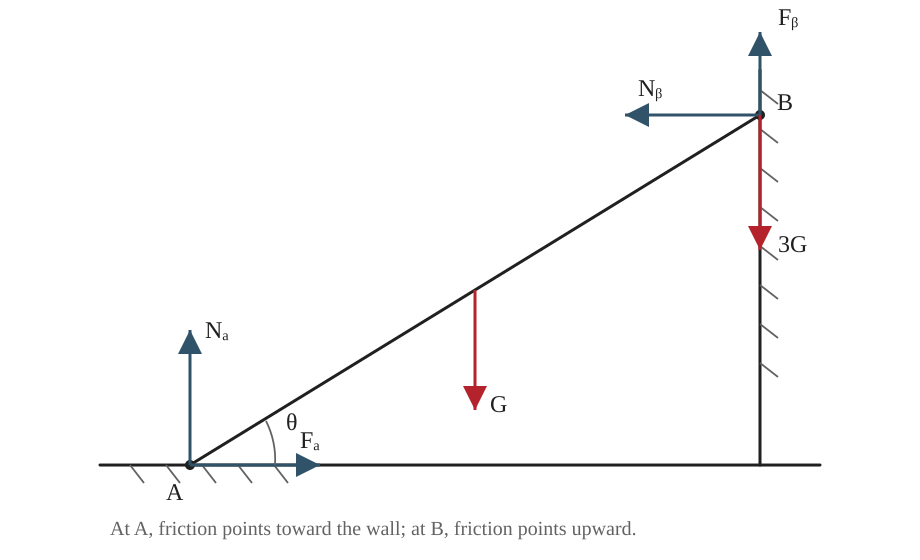

## 已知

均质梯子长为 $L$，自重为 $G$。地板与梯脚间的摩擦因数为

$$
\mu_A=\frac12,
$$

高墙与梯顶间的摩擦因数为

$$
\mu_B=\frac13.
$$

人的体重为梯子自重的三倍，即 $3G$，人位于梯顶。设梯子与地面的夹角为 $\theta$。

## 求

求梯子尚未滑动时，$\theta$ 的最小值。

## 解

**（1）受力分析**

梯脚 $A$ 处有地面支持力 $N_A$ 和摩擦力 $F_A$；梯顶 $B$ 处有墙面支持力 $N_B$ 和摩擦力 $F_B$。在临界滑动状态下，梯脚有向左滑动趋势，故 $F_A$ 向右；梯顶有向下滑动趋势，故 $F_B$ 向上。

**（2）列平衡方程与摩擦条件**

水平方向平衡：

$$
F_A-N_B=0,
\qquad F_A=N_B.
\tag{1}
$$

竖直方向平衡：

$$
N_A+F_B- G-3G=0,
\qquad N_A+F_B=4G.
\tag{2}
$$

静摩擦力满足 $F\le\mu N$。由式（1）、（2）及对梯脚取矩的方程可写出 $\tan\theta=(\frac72G-F_B)/N_B$。同时有 $F_B\le N_B/3$ 和 $N_B\le(4G-F_B)/2$。两条不等式给出 $F_B\le4G/7$。对给定的 $F_B$，取 $N_B=(4G-F_B)/2$ 可使 $\tan\theta$ 最小，此时 $\tan\theta=2(\frac72G-F_B)/(4G-F_B)$ 随 $F_B$ 递减。故最小倾角在 $F_B=4G/7$ 取得，两处接触均达到极限摩擦。

$$
F_A=\mu_A N_A=\frac12N_A,
\qquad F_B=\mu_B N_B=\frac13N_B.
\tag{3}
$$

由式（1）—（3）得

$$
N_B=\frac12N_A,
\qquad F_B=\frac16N_A.
$$

代入式（2）：

$$
N_A+\frac16N_A=4G,
\qquad N_A=\frac{24}{7}G.
$$

于是

$$
N_B=F_A=\frac{12}{7}G,
\qquad F_B=\frac47G.
\tag{4}
$$

**（3）对梯脚取矩**

以梯脚 $A$ 为矩心。梯顶坐标相对 $A$ 为 $(L\cos\theta,L\sin\theta)$，梯子重力作用于中点，人重力作用于梯顶。取逆时针为正：

$$
N_B L\sin\theta+F_B L\cos\theta
-G\frac L2\cos\theta-3GL\cos\theta=0.
$$

约去 $L\cos\theta$：

$$
N_B\tan\theta+F_B=\frac72G.
\tag{5}
$$

将式（4）代入式（5）：

$$
\frac{12}{7}G\tan\theta+\frac47G=\frac72G.
$$

整理得

$$
12\tan\theta+4=\frac{49}{2},
\qquad \tan\theta=\frac{41}{24}.
$$

## 答

$$
\boxed{\theta_{\min}=\arctan\frac{41}{24}\approx59.66^\circ}.
$$

与教材印刷答案一致。

## 阅卷要点

1. 正确判断梯脚、梯顶摩擦力方向。
2. 列出水平、竖直方向平衡方程。
3. 说明最小倾角的临界状态，并列出两处极限摩擦条件。
4. 求出四个接触反力的大小。
5. 对梯脚取矩并求出 $\tan\theta$。
